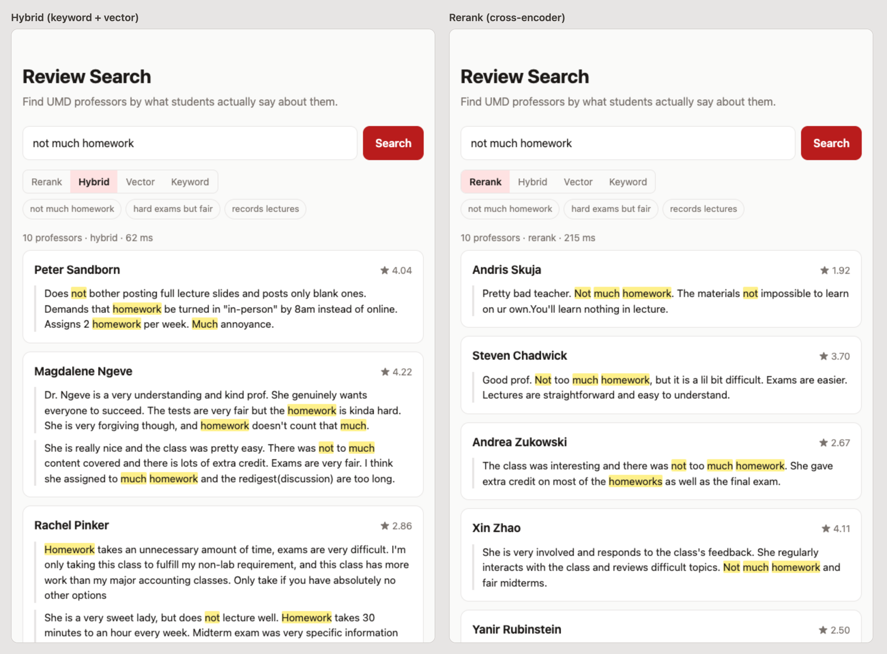

# prof-search

Search 46k+ UMD professor reviews from [PlanetTerp](https://planetterp.com) by meaning, not just keywords.

Four retrieval modes over the same data, keyword (Postgres full-text), vector (bge-small + pgvector HNSW), hybrid (reciprocal rank fusion), and a cross-encoder reranker, compared on 60 graded queries. Reranking raises nDCG@10 from 0.509 (keyword) and 0.636 (hybrid) to 0.735, at 155 ms p50.



Hybrid returns reviews that contain "not", "much" and "homework" but complain about the homework. Rerank returns reviews that say there isn't much of it.

## Run locally

Requires Docker and Python 3.12+.

```sh
make venv db migrate
make ingest    # ~145 API requests (~6 min first run), cached under .cache/
make embed     # chunk + embed reviews (~22 min on CPU)
make api       # search page at http://localhost:8000, API docs at /docs
```

## How a query runs

1. **Keyword:** Postgres full-text search, top 50 reviews.
2. **Vector:** bge-small query embedding against 54k review chunks in an HNSW index, top 50 reviews.
3. **Hybrid:** the two lists are merged with reciprocal rank fusion.
4. **Rerank:** a MiniLM cross-encoder reads the query next to each of the top 50 fused reviews and rescores them.
5. Reviews are collapsed into professors, scored by the rank-discounted sum of their best three reviews.

## Results

For each of 60 queries (teaching, grading, workload, course, contrast), the top 10 professors from every mode were pooled and graded 0/1/2, 1,413 judgments in total. Latency is in-process on an M4 Pro laptop.

| Method | Recall@10 | MRR | nDCG@10 | p50 ms |
|---|---|---|---|---|
| keyword | 0.374 | 0.764 | 0.509 | 40.0 |
| vector | 0.479 | 0.849 | 0.604 | 7.8 |
| hybrid | 0.494 | 0.872 | 0.636 | 54.6 |
| rerank | 0.547 | 0.893 | 0.735 | 154.5 |

Rerank wins every query type except course queries, where vector alone does best (0.723 vs 0.703). Per-type numbers are in [eval/results.md](eval/results.md).

**What each mode gets wrong**

- **Keyword** ranks short generic reviews first. "good for ECON200" matches every review containing "good", and `ts_rank` normalizes by length, so "Good." outranks reviews about ECON200 (keyword 0.00, vector 1.00).
- **Vector** loses exact details. "uses lots of real world examples" scored 0.03 vs keyword's 0.72. The embedding finds the topic without the phrase.
- **Neither** handles negation. "no exams, just projects" scored 0.00 in vector and hybrid, since every top result mentions both.
- **Rerank** fixes most negation ("not much homework" 0.31 → 0.86) because the cross-encoder reads query and review together. It still fails when the strongest phrase matches. "lenient grader who curves exams" dropped from 0.68 to 0.40 on reviews like "She doesn't curve but... is a very lenient grader".

**Tuning.** Feeding the reranker full 200-word chunks took 456 ms p50. Truncating to 64 words, close to the average passage length the model was trained on, cut that to 161 ms and scored higher. Graders also saw the start of each review, so some of that gain may be bias.

**Load.** With k6 at 10 concurrent users on one process, vector serves 282 req/s, hybrid 62 and rerank 12. Reranking is CPU bound.

## Limitations

- Course codes are matched as free text, not as exact filters, so course queries are the one type rerank doesn't win.
- Keyword search lets very short reviews outrank detailed ones, which crowds out better candidates for hybrid and rerank.
- Graders saw the start of each review, the same text the truncated reranker reads, so the truncation gain hasn't been checked against later parts of reviews.

## Development

```sh
make test      # integration tests against the review_test database
make lint
make label     # grade unjudged results in eval/queries.jsonl
make eval      # metrics per mode -> eval/results.md
make loadtest  # k6, override with MODE=hybrid VUS=10
```
